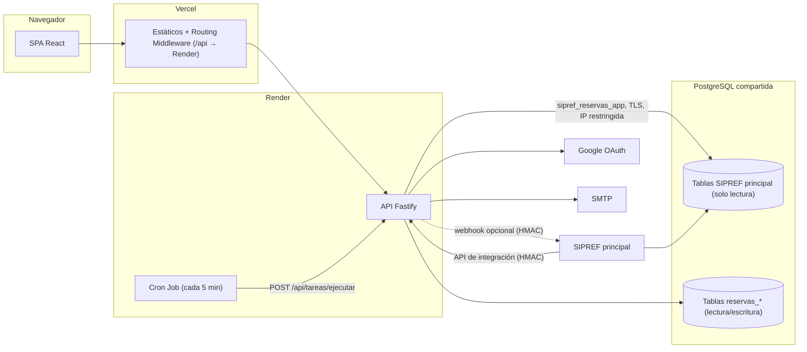

# Arquitectura — SIPREF Reservas

## 1. Contexto

SIPREF Reservas es un sistema **secundario** para reservar espacios de la Universidad Latino. Comparte la base de datos de **SIPREF principal**, el sistema oficial que está en producción, pero **no modifica nada de él**. La integración es aditiva:

- tablas nuevas con el prefijo `reservas_`;
- lectura de las tablas del principal con un usuario de privilegio mínimo;
- una API servidor a servidor que el principal consume para aprobar o rechazar el acceso.

## 2. Decisiones clave

| # | Decisión | Motivo |
|---|---|---|
| D1 | El frontend llama siempre a `/api` en su mismo dominio; el Routing Middleware de Vercel lo reenvía a Render | Cookies de primera parte (`SameSite=Lax`). Evita el bloqueo de cookies de terceros (Safari, Chrome) y no requiere CORS con credenciales |
| D2 | Flujo OAuth de **código de autorización + PKCE** del lado del servidor | El client secret vive solo en Render; las URIs de redirección se registran para Vercel y para local |
| D3 | `sub` de Google como clave primaria del usuario | El correo puede cambiar |
| D4 | Sesiones en la base (`reservas_sesiones`, guardando solo el hash del token) | Se pueden revocar al instante cuando un admin revoca una cuenta |
| D5 | SQL explícito (`pg`), sin ORM con sincronización automática | Ninguna herramienta puede alterar tablas ajenas por accidente |
| D6 | Adaptador único (`apps/api/src/principal/adaptador.ts`) para leer tablas del principal | Los nombres reales se ajustan en un solo lugar; todo es `SELECT` |
| D7 | Referencias **lógicas** (sin FK físicas) hacia tablas del principal | No crear dependencias que bloqueen `DELETE`/`UPDATE` del principal |
| D8 | Conflictos de horario: `pg_advisory_xact_lock` por espacio + verificación dentro de la transacción + restricción de exclusión opcional (V002) | Seguro ante concurrencia dentro de SIPREF Reservas |
| D9 | Auditoría propia (`reservas_auditoria`) en la **misma transacción** que la escritura; el rol de la app solo puede insertar y leer | Bitácora íntegra e inmutable para la app |
| D10 | Patrón outbox (`reservas_notificaciones_salida`) para webhooks y bitácora del principal | Las notificaciones no se pierden si el principal está caído, y no hay duplicados |
| D11 | Cancelación lógica; nunca se borran reservaciones | Conserva el historial y el expediente |
| D12 | Un Cron Job de Render llama a un endpoint protegido | Expira solicitudes (30 días configurable), envía recordatorios y procesa el outbox |

## 3. Concurrencia entre ambos sistemas

> [!WARNING]
> El candado transaccional solo coordina a quien lo use. Mientras SIPREF principal no adopte el mismo candado (o no consulte `reservas_reservaciones` / `GET /api/integracion/v1/ocupacion` al validar), queda una ventana de milisegundos en la que ambos sistemas podrían reservar el mismo espacio a la vez. La propuesta P4 en [PROPUESTA_CAMBIOS_SIPREF_PRINCIPAL.md](PROPUESTA_CAMBIOS_SIPREF_PRINCIPAL.md) la cierra con un cambio aditivo en el principal.

Clave de candado acordada: `pg_advisory_xact_lock(hashtext('reservas:espacio:' || <id_espacio>))`.

## 4. Seguridad

- **Secretos:** solo en variables de entorno de Render y Vercel. No hay credenciales en el repositorio; los archivos `.env.example` usan marcadores.
- **Base de datos:**
  - usuario dedicado `sipref_reservas_app`;
  - `SELECT` sobre las tablas del principal que se necesitan;
  - CRUD sobre `reservas_*`, excepto auditoría (solo `INSERT`/`SELECT`);
  - `statement_timeout`;
  - TLS obligatorio;
  - acceso restringido a las IP de salida de Render.
- **HTTP:**
  - `helmet` y límite de solicitudes;
  - cookies `HttpOnly` + `Secure`;
  - `state` + PKCE en OAuth;
  - validación con zod de toda entrada.
- **Integración:** HMAC-SHA256 con marca de tiempo (±5 min), comparación en tiempo constante y lista opcional de IP permitidas.
- **Bypass de desarrollo:** el servidor se niega a arrancar si `AUTH_DEV_BYPASS=true` en producción.
- **Logs:** nunca registran tokens, cookies, secretos ni la cadena de conexión.

## 5. Entornos

| Entorno | Base de datos | Uso |
|---|---|---|
| Local | Docker `postgres:16` con *stub* que simula las tablas del principal (`db/local`) | Desarrollo y pruebas automatizadas |
| Staging | **Copia** de la base de SIPREF (sin datos personales o anonimizada) | Primera validación integrada — obligatoria antes de producción |
| Producción | Base compartida de SIPREF | Solo después de aprobar migraciones, roles y la propuesta para el principal |
