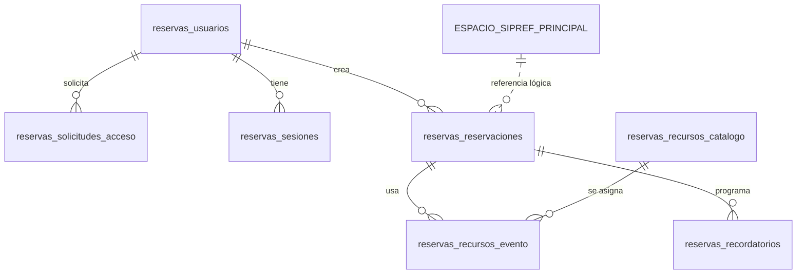

# Modelo de datos propuesto — para revisión del equipo de SIPREF principal

> [!IMPORTANT]
> Nada de este documento se ha ejecutado en la base compartida. Los scripts están en `db/migrations/` y `db/roles/`, y esperan aprobación.

## 1. Resumen de impacto sobre SIPREF principal

| Tipo de cambio | ¿Se propone? |
|---|---|
| `ALTER` / `DROP` / `RENAME` sobre tablas existentes | **No** |
| Columnas nuevas en tablas existentes | **No** |
| Llaves foráneas físicas hacia tablas existentes | **No** (referencias lógicas validadas en el backend) |
| Triggers sobre tablas existentes | **No** |
| Tablas nuevas | Sí, 10, todas con prefijo `reservas_` |
| Roles nuevos | Sí: `sipref_reservas_app` (aplicación) y `sipref_reservas_migrator` (migraciones) |
| Extensión `btree_gist` | Opcional (V002), requiere DBA |

**Alternativa recomendada:** crear un esquema exclusivo `reservas` (`CREATE SCHEMA reservas AUTHORIZATION sipref_reservas_migrator`) además del prefijo. Aísla los permisos (no se necesita `CREATE` sobre `public`). El cambio en el código sería solo el `search_path`. Requiere aprobación.

## 2. Tablas existentes de SIPREF principal que se usan (solo lectura)

Los nombres reales están **pendientes de confirmar**. Se leen exclusivamente desde `apps/api/src/principal/adaptador.ts`.

| Dato | Uso en SIPREF Reservas | Columnas mínimas | Permiso |
|---|---|---|---|
| Espacios / aulas | Selector de espacio, capacidad, filtro del calendario | id, nombre, capacidad, tipo, edificio, activo | `SELECT` |
| Reservaciones del principal | Mostrar ocupación y detectar conflictos | id, espacio_id, título, responsable, inicio, fin, estado | `SELECT` |
| Usuarios administradores (opcional) | Mostrar nombre de quien aprobó (el principal también lo manda en la API) | id, nombre | `SELECT` por columna |

No se duplican datos del principal. La única excepción documentada: `reservas_reservaciones.espacio_nombre` guarda **una copia informativa** del nombre del espacio al momento de reservar, para que el expediente oficial sea fiel aunque el espacio cambie de nombre. No se sincroniza a propósito: es un registro histórico.

## 3. Tablas nuevas

### `reservas_configuracion`

Parámetros editables sin redesplegar.

| Columna | Tipo | Restricciones | Descripción |
|---|---|---|---|
| clave | text | PK | `solicitud_expiracion_dias`, `buffer_minutos`, `ciclo_actual`, `dominios_permitidos`, `zona_horaria` |
| valor | jsonb | NOT NULL | Valor |
| descripcion | text | | |
| actualizado_en | timestamptz | NOT NULL, default now() | |

### `reservas_usuarios`

Cuentas Google.

| Columna | Tipo | Restricciones | Descripción |
|---|---|---|---|
| google_sub | text | **PK** | Identificador estable de Google |
| correo | text | NOT NULL, índice en lower() | Puede cambiar; se actualiza en cada inicio de sesión |
| correo_verificado | boolean | default false | `email_verified` de Google |
| nombre, foto_url | text | | |
| rol | text | CHECK `DOCENTE`/`PERSONAL`/`ADMIN_ESPACIOS` | Obligatorio si está `APROBADA` |
| estado | text | CHECK 5 estados, default `PENDIENTE` | Estado vigente de la cuenta |
| creado_en, actualizado_en, ultimo_acceso_en | timestamptz | | |

### `reservas_solicitudes_acceso`

Historial de solicitudes.

| Columna | Tipo | Restricciones | Descripción |
|---|---|---|---|
| id | uuid | PK | |
| google_sub | text | FK → reservas_usuarios | |
| correo, nombre, foto_url | text | | Copia al momento del intento (lo que vio el admin) |
| estado | text | CHECK | `PENDIENTE`, `APROBADA`, `RECHAZADA`, `REVOCADA`, `EXPIRADA` |
| intentado_en, ultimo_intento_en | timestamptz | | Fecha y hora del intento |
| intentos | int | ≥ 1 | Reintentos sin generar notificación nueva |
| expira_en | timestamptz | NOT NULL | intentado_en + 30 días (configurable) |
| rol_asignado | text | CHECK; obligatorio si `APROBADA` | |
| resuelto_por_id, resuelto_por_nombre | text | | Administrador de SIPREF principal |
| resuelto_en | timestamptz | Coherente con estado (CHECK) | |
| motivo | text | | Motivo de rechazo o revocación |
| ip_origen, user_agent | text | | |

**Índice único parcial** `(google_sub) WHERE estado='PENDIENTE'`: garantiza a nivel base de datos que no existan dos solicitudes pendientes (ni notificaciones duplicadas) para la misma cuenta.

### `reservas_sesiones`

`token_hash` (PK, SHA-256), `google_sub` (FK), `creado_en`, `expira_en`, `revocada_en`, `ip`, `user_agent`.

### `reservas_recursos_catalogo`

`id` serial PK, `nombre` (único sin distinguir mayúsculas), `unidad`, `activo`, `es_predefinido`, `creado_por` (FK usuario), `creado_en`. Se precarga con micrófono, sillas, mesas, proyector, computadora, bocina, extensión, mampara, pizarra y pantalla.

### `reservas_reservaciones`

| Columna | Tipo | Restricciones |
|---|---|---|
| id | uuid | PK |
| codigo | text | UNIQUE (`RES-AAAA-NNNNNN` si no se captura) |
| tipo_evento | text | CHECK `CONFERENCIA`/`TALLER`/`JUNTA`/`EXAMEN`/`OTRO` |
| espacio_id | text | NOT NULL, referencia **lógica** al espacio del principal |
| espacio_nombre | text | Copia histórica |
| nombre_evento | text | No vacío |
| inicio, fin | timestamptz | `fin > inicio`, duración ≤ 24 h |
| responsable, correo_responsable, descripcion, observaciones | text | |
| asistentes_estimados | int | ≥ 0 |
| estado | text | `PROGRAMADA`/`CANCELADA` (`REALIZADA` se deriva) |
| creado_por, cancelado_por | text | FK → reservas_usuarios |
| creado_en, actualizado_en, cancelado_en | timestamptz | Cancelación coherente (CHECK) |
| motivo_cancelacion | text | |
| version | int | Concurrencia optimista al reagendar |

Índices: `(espacio_id, inicio, fin) WHERE estado='PROGRAMADA'`, `(inicio)`, `(creado_por)`.

V002 (opcional) agrega `EXCLUDE USING gist (espacio_id WITH =, tstzrange(inicio, fin + 15 min) WITH &&) WHERE estado='PROGRAMADA'`.

### `reservas_recursos_evento`

PK `(reservacion_id, recurso_id)`, `cantidad` entre 1 y 10000, `notas`. Se borra en cascada con la reservación (que nunca se borra en la operación normal).

### `reservas_recordatorios`

`id`, `reservacion_id` (FK cascade), `canal` (`SIPREF`/`CORREO`), `anticipacion` > 0, `unidad` (`MINUTOS`/`HORAS`/`DIAS`), `enviar_en`, `enviado_en`, `intentos`, `ultimo_error`. Índice parcial de pendientes.

### `reservas_notificaciones_salida` (outbox)

`id`, `tipo`, `clave_idempotencia` (UNIQUE), `payload` jsonb, `creado_en`, `entregado_en`, `intentos`, `proximo_intento_en`, `ultimo_error`.

### `reservas_auditoria`

`id`, `ocurrido_en`, `actor_tipo` (`USUARIO_RESERVAS`/`ADMIN_PRINCIPAL`/`SISTEMA`), `actor_id`, `actor_nombre`, `accion`, `entidad`, `entidad_id`, `datos_antes`, `datos_despues`, `ip`, `user_agent`. **Inmutable para la app:** solo `INSERT`/`SELECT`.

## 4. Diagrama

## 5. Proceso de aprobación sugerido

1. El equipo de SIPREF principal revisa este documento y `db/migrations/V001…sql`.
2. El DBA confirma los nombres reales de las tablas del principal y ajusta los `GRANT SELECT` de `db/roles/R001…sql`.
3. Se aplica en **staging** (copia de la base): roles → V001 → (opcional) V002.
4. Se corren las pruebas de integración contra staging.
5. Con el visto bueno, se aplica en producción en una ventana acordada y con respaldo previo.
6. Reversa disponible: `V00X…down.sql`, que solo elimina objetos `reservas_*`.
